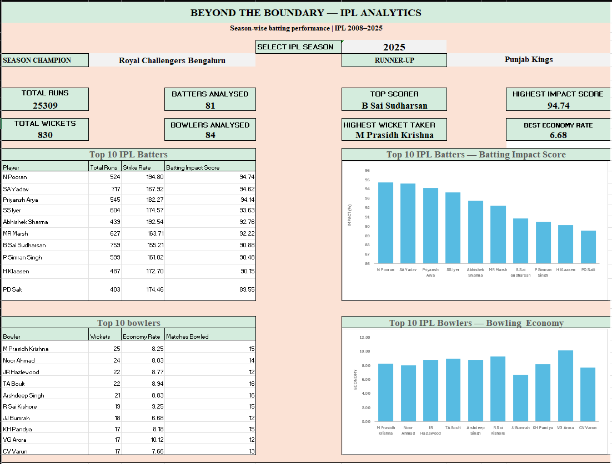

<div align="center">

# Beyond the Boundary — IPL Analytics
<p align="center">
    
</p>

### Turning Cricket Data into Performance Insights

**An Excel-based sports analytics project exploring IPL batting and bowling performance from 2008 to 2025.**


</div>

---

## Project Overview

**Beyond the Boundary — IPL Analytics** is a data analytics project developed using Microsoft Excel to analyse Indian Premier League (IPL) player performances across seasons.

The project transforms ball-by-ball delivery data and match information into meaningful batting and bowling statistics. An interactive dashboard presents key performance indicators (KPIs), Top 10 player rankings, and charts to help users explore season-wise performance.

---

## Objectives

- Analyse IPL batting and bowling performance across seasons.
- Compare batters using total runs, strike rate, and boundary contribution.
- Evaluate bowlers using wickets, economy rate, and matches bowled.
- Build an interactive Excel dashboard with season selection.
- Present player statistics through KPI cards, tables, and charts.
- Practise data cleaning, formula-based analysis, and data visualization.

---

## Dataset

**Dataset:** IPL Ball-by-Ball Delivery Data and Match Data

**Coverage:** IPL seasons available in the source dataset through 2025.

### Files Used

- `deliveries_updated_ipl_upto_2025.csv`
- `matches_updated_ipl_upto_2025.csv`

Additional CSV files are stored in the `01_Raw_Data` folder for reference and potential further analysis.

**Dataset Source:** IPL Dataset on Kaggle

---

## Key Features

- Season-wise IPL performance analysis.
- Interactive season selector.
- Season champion and runner-up overview.
- Total runs and total wickets KPIs.
- Batters and bowlers analysed.
- Top scorer and highest wicket-taker.
- Highest Batting Impact Score and best economy rate.
- Top 10 batter and bowler tables.
- Batting impact and bowling economy charts.

---

## Batting Analysis

The batting analysis evaluates players using:

| Metric | Description |
|---|---|
| Total Runs | Total runs scored by a batter |
| Balls Faced | Deliveries counted as balls faced under the workbook's formula |
| Strike Rate | Runs scored per 100 balls faced |
| Fours | Number of boundaries worth four runs |
| Sixes | Number of boundaries worth six runs |
| Boundary Runs | Runs scored through fours and sixes |
| Batting Impact Score | Custom weighted score for comparing batters within a season |

### Batting Impact Score

The project uses a custom score based on within-season percentile rankings.

| Component | Weight |
|---|---:|
| Total Runs Percentile | 40% |
| Strike Rate Percentile | 30% |
| Boundary Runs Percentile | 30% |

**Formula:**

`Batting Impact Score = (Runs Percentile × 0.40) + (Strike Rate Percentile × 0.30) + (Boundary Runs Percentile × 0.30)`

Batters must have faced at least 60 balls in a season to meet the workbook's eligibility threshold.

*This is a project-defined metric, not an official IPL rating.*

---

## Bowling Analysis

The bowling analysis compares bowlers using:

| Metric | Description |
|---|---|
| Total Wickets | Wickets credited to the bowler under the workbook's dismissal rules |
| Runs Conceded | Runs charged to the bowler under the workbook's calculation |
| Legal Balls Bowled | Deliveries excluding wides and no-balls |
| Economy Rate | Runs conceded per six legal balls |
| Matches Bowled | Distinct matches in which the bowler appears in the delivery data |
| Wickets per Match | Total wickets divided by matches bowled |

Bowlers must have bowled at least 60 legal balls in a season to meet the workbook's eligibility threshold.

---

## Technologies Used

| Category | Technologies |
|---|---|
| Data Analysis | Microsoft Excel |
| Data Aggregation | `SUMIFS`, `COUNTIFS` |
| Data Lookup | `XLOOKUP` |
| Dynamic Arrays | `LET`, `FILTER`, `UNIQUE`, `HSTACK`, `SORTBY`, `CHOOSECOLS` |
| Data Visualization | Excel Charts |
| Dashboard Design | KPI Cards, Tables, Charts |
| Data Processing | Filtering, grouping, aggregation, percentile ranking |

---

## Repository Structure

```text
Beyond-the-Boundary-IPL-Analytics/
│
├── README.md
│
├── 01_Raw_Data/
│   ├── deliveries_updated_ipl_upto_2025.csv
│   ├── deliveries_updated_mens_ipl.csv
│   ├── IPL_Auction_Historical.csv
│   ├── IPL_ball_by_ball_updated.csv
│   ├── matches_updated_ipl_upto_2025.csv
│   └── matches_updated_mens_ipl.csv
│
├── 02_Working_Files/
│   └── IPL_Moneyball_Analysis.xlsx
│
├── 03_Final_Dashboard/
│   └── dashboard Screenshot.png
│
└── screenshots/
    └── dashboard.png
```

---

## Dashboard Preview

<p align="center">
  
</p>

---

## How to Use

1. Clone or download this repository.
2. Open `02_Working_Files/IPL_Moneyball_Analysis.xlsx` in a recent desktop version of Microsoft Excel.
3. Navigate to the `Dashboard` worksheet.
4. Select an IPL season using the season selector.
5. Explore the KPI cards, Top 10 player tables, and charts.

The workbook uses modern Excel functions, including dynamic-array formulas. A compatible version of Microsoft Excel is recommended.

---

## Results

The dashboard provides a consolidated view of season-wise batting and bowling performance.

Users can explore:

- Top-performing batters under the custom Batting Impact Score.
- Bowlers with the highest wicket counts.
- Economy-rate differences between bowlers.
- Season champions and runners-up.
- Changes in player rankings across seasons.

The rankings depend on the metrics, eligibility thresholds, and source data used in the workbook.

---

## Future Improvements

- Add bowling average and bowling strike-rate analysis.
- Improve automated data validation.
- Add more season-wise comparisons.
- Explore player performance alongside verified auction-price data.
- Develop a Power BI dashboard using the prepared data.

---

## Author

**Kirankumar K**

Computer Science and Data Science Engineering

RNS Institute of Technology

**GitHub:** https://github.com/Kirankumar-K18

---

## License

This project is intended for educational and portfolio purposes. Review the original dataset licences before redistributing raw data.

<div align="center">

**Beyond the Boundary — IPL Analytics 🏏**

*Turning Cricket Data into Performance Insights*

</div>
